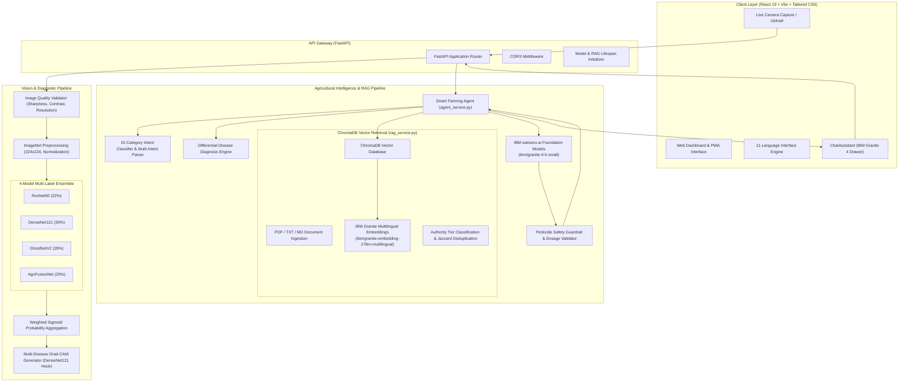

# 🌿 LeafSense: AI-Powered Plant Disease Detection & Smart Farming Assistant

> **AI-Powered Plant Disease Detection, Explainable AI and Intelligent Farming Guidance.**

[](https://www.python.org/)
[](https://fastapi.tiangolo.com/)
[](https://react.dev/)
[](https://vite.dev/)
[](https://pytorch.org/)
[](https://www.ibm.com/products/watsonx-ai)
[](https://www.trychroma.com/)
[](#12-testing)

---

## Table of Contents

1. [Project Overview](#1-project-overview)
2. [Key Features](#2-key-features)
3. [Screenshots and Demo](#3-screenshots-and-demo)
4. [System Architecture](#4-system-architecture)
5. [Technology Stack](#5-technology-stack)
6. [Supported Crops and Disease Classes](#6-supported-crops-and-disease-classes)
7. [Installation and Local Setup](#7-installation-and-local-setup)
8. [Environment Variables and IBM watsonx.ai Setup](#8-environment-variables-and-ibm-watsonxai-setup)
9. [Agriculture Knowledge Base Setup](#9-agriculture-knowledge-base-setup)
10. [API Documentation](#10-api-documentation)
11. [Project Folder Structure](#11-project-folder-structure)
12. [Testing](#12-testing)
13. [Model Training and Dataset Transparency](#13-model-training-and-dataset-transparency)
14. [Deployment Guide](#14-deployment-guide)
15. [Responsible AI and Limitations](#15-responsible-ai-and-limitations)
16. [Roadmap](#16-roadmap)
17. [Contributing](#17-contributing)
18. [Security](#18-security)
19. [License and Credits](#19-license-and-credits)
20. [Contact and Acknowledgements](#20-contact-and-acknowledgements)

---

## 1. Project Overview

Plant diseases cause substantial annual crop yield losses globally, severely threatening smallholder farm incomes and food security. Early, accurate diagnosis is often bottlenecked by limited access to trained plant pathologists, delayed laboratory testing, and misapplication of chemical pesticides.

**LeafSense** is an open-source agricultural intelligence platform developed to address this challenge. It unites **multi-label deep learning vision models**, **visual explainability (Grad-CAM)**, and an **interactive conversational agent powered by IBM watsonx.ai Granite 4** backed by a **localized Agriculture RAG knowledge base**.

### How It Works
1. **Foliage Image Capture:** A farmer captures or uploads a leaf photo via web or mobile camera.
2. **Quality Pre-Flight Screening:** Automated algorithms evaluate image sharpness, contrast, and resolution.
3. **Ensemble Vision Inference:** A 4-model neural network ensemble (ResNet50, DenseNet121, GhostNetV2, AgriFusionNet) predicts active diseases across 17 supported classes.
4. **Visual Localization (Grad-CAM):** Color-coded class activation heatmaps highlight exact infected regions on the leaf.
5. **Interactive Farming Advisory:** An integrated conversational assistant powered by **IBM Granite 4** (`ibm/granite-4-h-small`) retrieves verified agronomic literature from **ChromaDB**, identifies the farmer's specific intent, checks pairwise differential symptoms, and offers safe, step-by-step guidance in English and Hindi.

### Target Beneficiaries
- **Smallholder & Commercial Farmers:** Immediate preliminary diagnosis and non-chemical/chemical management steps.
- **Agricultural Extension Workers & KVK Scientists:** Digital diagnostic companion during field inspections.
- **Agronomy Students & Researchers:** Transparent platform for exploring multi-label plant pathology and explainable AI.

---

## 2. Key Features

### A. AI Plant Disease Detection
- **17 Disease Classes across 5 Crops:** Supports Apple, Corn (Maize), Grape, Potato, and Tomato.
- **Multi-Disease Co-Occurrence:** Simultaneously detects multiple concurrent fungal, bacterial, or viral infections on the same foliage.
- **4-Model Ensemble:** Combines DenseNet121 (30%), GhostNetV2 (28%), ResNet50 (22%), and custom AgriFusionNet (20%) via calibrated weighted sigmoid aggregation.
- **Pre-Flight Image Validation:** Verifies minimum resolution ($\ge 224 \times 224$), checks illumination/contrast, and calculates blur using Laplacian variance ($\sigma^2 \ge 100$).
- **Multi-Source Ingestion:** Drag-and-drop file upload, clipboard paste, or real-time camera capture.

### B. Explainable AI (Grad-CAM)
- **Visual Attention Heatmaps:** Extracts gradients from DenseNet121's deepest convolutional layer (`features.denseblock4.denselayer16.conv2`).
- **Color-Coded Localization:** Renders distinct spectral overlays for detected conditions (Red, Yellow, Blue, Green, Purple).
- **Composite Visualization:** Unifies multiple detected conditions onto a single leaf heatmap with dynamic color legends.
- **Transparency on Limitations:** Explicitly communicates that heatmaps indicate model visual correlation, not biological proof.

### C. Smart Farming AI Assistant
- **Foundation LLM:** Powered by **IBM Granite 4** (`ibm/granite-4-h-small`) via the official `ibm-watsonx-ai` SDK.
- **15 Agricultural Intents:** Classifies queries across disease diagnosis, chemical controls, organic alternatives, soil preparation, crop rotation, NPK nutrition, drip irrigation, and weather impacts.
- **Multi-Intent Handling:** Deconstructs compound inquiries (e.g. *"How do I treat blight and what should I rotate next season?"*) into coherent, multi-part answers.
- **Differential Disease Diagnosis:** Generates side-by-side comparative marker cards and targeted field verification probes for overlapping diseases (e.g., Early Blight vs. Septoria Leaf Spot).
- **Conversational Memory:** Maintains 12-attribute progressive farmer profiles across multi-turn sessions, resolves pronoun references, and gracefully handles corrections (*"Actually it is Potato not Tomato"*).
- **Bilingual Chat:** Full conversational fluency in English and Hindi (`हिं`).

### D. Agriculture RAG Knowledge Base
- **ChromaDB Vector Store:** Embedded vector store persisting agricultural research documents locally.
- **IBM Granite Multilingual Embeddings:** Dense vector generation via `ibm/granite-embedding-278m-multilingual`.
- **Multi-Format Ingestion:** Ingests PDF (`pypdf`), Plain Text (`.txt`), and Markdown (`.md`).
- **Source Authority Classification:** Categorizes sources into `official_guidance` (ICAR, KVK, SAUs), `verified_research`, or `agricultural_reference`.
- **Citation Transparency:** In-line citation cards display document names, page numbers, match percentages, and snippet excerpts.

### E. Responsible AI & Safety Guardrails
- **Zero Chemical Hallucination:** Refuses to fabricate unsupported pesticide dosages or metric concentrations without verified official literature backing.
- **Uncertainty Transparency:** Highlights prediction uncertainty when confidence is $<0.50$, advising on-site extension confirmation.
- **Safety Disclaimers:** Appends explicit safety notices directing farmers to container labels and local Krishi Vigyan Kendra (KVK) specialists.

---

## 3. Screenshots and Demo

> **Note:** To maintain strict authenticity, no simulated or fabricated screenshots are committed to the repository. The paths below reflect the visual capture layout.

| Interface View | Screenshot Placeholder |
|:---|:---|
| **Main Diagnostic Dashboard** | `docs/images/dashboard.png` *(Capture main foliage upload & camera interface)* |
| **Multi-Disease Diagnosis Results** | `docs/images/diagnosis.png` *(Capture confidence scores & quality check)* |
| **Color-Coded Grad-CAM Overlays** | `docs/images/gradcam.png` *(Capture individual & composite heatmaps)* |
| **Interactive Assistant & RAG Citations** | `docs/images/ai-assistant.png` *(Capture reasoning accordion & source citations)* |
| **Bilingual Hindi Consultation** | `docs/images/hindi-chat.png` *(Capture multi-turn consultation in Hindi)* |

*For screenshot capturing guidelines and recommended dimensions, see [docs/images/README.md](docs/images/README.md).*

---

## 4. System Architecture



*For comprehensive architectural specifications and mathematical formulations, see [docs/ARCHITECTURE.md](docs/ARCHITECTURE.md).*

---

## 5. Technology Stack

### Frontend
| Component | Technology | Version / Specification |
|:---|:---|:---|
| **Framework** | React | `^19.2.6` |
| **Build Tool** | Vite | `^8.0.12` |
| **Styling** | Tailwind CSS & Autoprefixer | `^3.4.19` |
| **Iconography** | Lucide React | `^1.17.0` |
| **Export Tooling** | html2canvas | `^1.4.1` |
| **Linting** | ESLint | `^10.3.0` |

### Backend
| Component | Technology | Version / Specification |
|:---|:---|:---|
| **Language** | Python | `3.10`, `3.11`, `3.12`, `3.13` compatible |
| **API Framework** | FastAPI | `^0.115.0` |
| **ASGI Server** | Uvicorn | `^0.34.0` |
| **Data Validation** | Pydantic | `^2.10.0` |
| **Image Processing** | Pillow (PIL) | `^11.0.0` |
| **Testing** | Pytest & AnyIO | `pytest ^9.2.0`, `anyio ^4.16.0` |

### Deep Learning & Vision
| Component | Technology | Role |
|:---|:---|:---|
| **Framework** | PyTorch & Torchvision | Neural inference and tensor operations |
| **Model Registry** | `timm` (PyTorch Image Models) | GhostNetV2 backbone instantiation |
| **Models** | ResNet50, DenseNet121, GhostNetV2, AgriFusionNet | 4-Model multi-label diagnostic ensemble |

### Foundation AI & Knowledge Base
| Component | Technology | Role |
|:---|:---|:---|
| **SDK** | `ibm-watsonx-ai` | Official IBM watsonx.ai Python SDK |
| **Foundation Model** | IBM Granite 4 (`ibm/granite-4-h-small`) | Multi-turn reasoning and conversational advisory |
| **Embedding Model** | IBM Granite Multilingual (`ibm/granite-embedding-278m-multilingual`) | Dense vector generation for RAG |
| **Vector Database** | ChromaDB | Persistent vector storage and semantic search |
| **Document Parser** | `pypdf` | Extraction of agricultural PDF literature |

---

## 6. Supported Crops and Disease Classes

LeafSense identifies **17 distinct plant disease classes** across **5 key crops**:

| Crop | Supported Disease Class Identifiers | Number of Classes |
|:---|:---|:---:|
| **Apple** | `Apple___Apple_scab`, `Apple___Black_rot`, `Apple___Cedar_apple_rust` | 3 |
| **Corn (Maize)** | `Corn_(maize)___Cercospora_leaf_spot Gray_leaf_spot`, `Corn_(maize)___Common_rust_`, `Corn_(maize)___Northern_Leaf_Blight` | 3 |
| **Grape** | `Grape___Black_rot`, `Grape___Esca_(Black_Measles)`, `Grape___Leaf_blight_(Isariopsis_Leaf_Spot)` | 3 |
| **Potato** | `Potato___Early_blight`, `Potato___Late_blight` | 2 |
| **Tomato** | `Tomato___Early_blight`, `Tomato___Late_blight`, `Tomato___Septoria_leaf_spot`, `Tomato___Target_Spot`, `Tomato___Tomato_mosaic_virus`, `Tomato___Tomato_Yellow_Leaf_Curl_Virus` | 6 |
| **Total** | — | **17 Classes** |

*For deep architectural details on model layers, weights, and dataset lineage, see [docs/DATASET_AND_MODELS.md](docs/DATASET_AND_MODELS.md).*

---

## 7. Installation and Local Setup

### Prerequisites
- **Operating System:** Linux (Ubuntu 20.04+ recommended), macOS, or Windows (WSL2).
- **Python:** Version `3.10`, `3.11`, `3.12`, or `3.13`.
- **Node.js:** Version `18.x` or higher with `npm` `9.x+`.
- **Git**

---

### Step 1: Clone the Repository
```bash
git clone https://github.com/RudraMandloi834/Leafsense.git
cd Leafsense
```

---

### Step 2: Backend Setup

1. **Navigate to the backend directory and create a virtual environment:**
   ```bash
   cd backend
   python3 -m venv .venv
   source .venv/bin/activate
   ```

2. **Install Python dependencies:**
   ```bash
   pip install --upgrade pip
   pip install -r requirements.txt
   ```

3. **Configure Environment Variables:**
   ```bash
   cp .env.example .env
   # Edit .env with your IBM watsonx.ai credentials
   ```

4. **Start the FastAPI Backend:**
   ```bash
   uvicorn app:app --reload --host 0.0.0.0 --port 8000
   ```
   *The backend will be running at `http://localhost:8000`.*
   *Interactive API documentation is available at `http://localhost:8000/docs`.*

---

### Step 3: Frontend Setup

1. **Open a new terminal, navigate to the frontend directory:**
   ```bash
   cd frontend
   ```

2. **Install Node dependencies:**
   ```bash
   npm install
   ```

3. **Start the Vite Development Server:**
   ```bash
   npm run dev
   ```
   *The web application will be accessible at `http://localhost:5173`.*

---

## 8. Environment Variables and IBM watsonx.ai Setup

All backend secrets reside in `backend/.env`. A template is provided in `backend/.env.example`:

```bash
# IBM Cloud & watsonx.ai Credentials
WATSONX_API_KEY=your_ibm_cloud_api_key_here
WATSONX_PROJECT_ID=your_watsonx_project_id_here
WATSONX_URL=https://us-south.ml.cloud.ibm.com

# Model Configuration
WATSONX_MODEL_ID=ibm/granite-4-h-small
WATSONX_EMBEDDING_MODEL_ID=ibm/granite-embedding-278m-multilingual

# Server Configuration
HOST=0.0.0.0
PORT=8000
```

### Obtaining IBM watsonx.ai Credentials
1. Create or log into an [IBM Cloud Account](https://cloud.ibm.com/).
2. Navigate to [IBM Cloud IAM API Keys](https://cloud.ibm.com/iam/apikeys) and generate a new API key (`WATSONX_API_KEY`).
3. Open [watsonx.ai](https://dataplatform.cloud.ibm.com/), create a new project, and copy your Project ID from the **Manage > General** tab (`WATSONX_PROJECT_ID`).
4. Ensure your project is in the **Dallas (`us-south`)** region (`WATSONX_URL=https://us-south.ml.cloud.ibm.com`).
5. *Note: Foundation model availability depends on your IBM Cloud region, project access, and account entitlements.*

---

## 9. Agriculture Knowledge Base Setup

LeafSense uses **ChromaDB** to index agricultural reference literature.

### Adding Documents & Ingesting
1. Place PDF, TXT, or Markdown documents in `backend/knowledge_base/documents/`:
   ```bash
   cp /path/to/icar_crop_guide.pdf backend/knowledge_base/documents/
   ```
2. Run the ingestion pipeline:
   ```bash
   cd backend
   source .venv/bin/activate
   python ingest_documents.py
   ```
3. Inspect vector indexing status via the API:
   ```bash
   curl http://localhost:8000/api/rag/status
   ```

*For chunking strategies, metadata schemas, and recommended ICAR/KVK literature, see [docs/RAG_SETUP.md](docs/RAG_SETUP.md).*

---

## 10. API Documentation

| Method | Endpoint | Purpose | Request Payload | Response Overview |
|:---:|:---|:---|:---|:---|
| `GET` | `/` | Service root status | None | Mode, model count, status |
| `GET` | `/health` | Health & device diagnostics | None | PyTorch state, GPU device, model readiness |
| `POST` | `/check-quality` | Foliage image quality screening | `file` (multipart/form-data) | Blur variance, contrast, sharpness, pass/fail |
| `POST` | `/predict` | Multi-disease ensemble inference | `file`, `language` (form) | Predictions, Grad-CAM images, translated advice |
| `POST` | `/translate-advice` | Ad-hoc treatment translation | JSON `{advice, target_language}` | Translated crop advice in 11 languages |
| `GET` | `/api/rag/status` | Vector knowledge base status | None | Total docs, chunks, embedding model |
| `POST` | `/api/rag/ingest` | Document ingestion endpoint | `file` (multipart/form-data) | Chunks created, collection total |
| `POST` | `/api/rag/query` | Semantic vector search | JSON `{query, top_k, crop}` | Top-k relevant chunks with citations |
| `POST` | `/api/agent/recommend` | Conversational farming consultation | JSON `{question, crop, location...}` | Granite answer, citations, differential analysis |
| `POST` | `/api/agent/session/reset` | Reset conversational memory | JSON `{conversation_id}` | Reset confirmation status |
| `GET` | `/api/agent/session/{id}` | Retrieve session state | Path `{conversation_id}` | Profile, stage, conversation history |

*For complete JSON schemas, error codes, and curl examples, see [docs/API.md](docs/API.md).*

---

## 11. Project Folder Structure

```
LeafSense/
├── backend/
│   ├── app.py                     # Main FastAPI application router and lifespan handlers
│   ├── app_lite.py                # Lightweight single-model entry point for constrained hosts
│   ├── agent_service.py           # Cognitive Smart Farming Agent & multi-intent reasoning
│   ├── rag_service.py             # ChromaDB vector retrieval & authority classification
│   ├── watsonx_service.py         # IBM watsonx.ai SDK integration & error sanitization
│   ├── gradcam.py                 # Multi-disease Grad-CAM visualization generator
│   ├── image_quality.py           # Laplacian blur, contrast, and resolution checker
│   ├── ingest_documents.py        # CLI document chunking and ingestion utility
│   ├── utils.py                   # Class labels, color palettes, and image decoders
│   ├── requirements.txt           # Python dependency specifications
│   ├── .env.example               # Backend environment variable template
│   ├── knowledge_base/
│   │   ├── documents/             # Agricultural literature storage (.pdf, .txt, .md)
│   │   └── chroma_db/             # Local ChromaDB persistent vector database (gitignored)
│   └── tests/
│       ├── test_advanced_reasoning.py   # Intent classification & differential reasoning tests
│       ├── test_conversational_agent.py # Multi-turn memory & session isolation tests
│       ├── test_agent.py                # Core agent logic and question generation
│       ├── test_api.py                  # Prediction, quality check, and health endpoint tests
│       ├── test_edge_cases.py           # Safety, dosage guardrails, and error handling
│       ├── test_rag.py                  # ChromaDB ingestion and semantic search tests
│       └── test_watsonx.py              # IBM watsonx.ai SDK and token masking tests
├── frontend/
│   ├── index.html                 # Semantic HTML entry point with JSON-LD structured data
│   ├── package.json               # Frontend Node dependencies and scripts
│   ├── vite.config.js             # Vite bundler configuration
│   ├── public/
│   │   ├── favicon.svg            # LeafSense vector application icon
│   │   ├── manifest.json          # Progressive Web App manifest
│   │   ├── robots.txt             # Web crawler indexing directives
│   │   └── sitemap.xml            # Search engine XML sitemap
│   └── src/
│       ├── App.jsx                # Main diagnostic dashboard and image upload interface
│       ├── ChatAssistant.jsx      # Interactive Smart Farming Chatbot drawer
│       ├── CameraCapture.jsx      # Real-time mobile/desktop camera capture module
│       ├── translations.js        # Multilingual UI localization strings
│       └── main.jsx               # React DOM root mounting
├── docs/
│   ├── ARCHITECTURE.md            # In-depth system architecture & ensemble formulas
│   ├── API.md                     # Comprehensive RESTful API endpoint reference
│   ├── DATASET_AND_MODELS.md      # Model architectures, layers, and dataset transparency
│   ├── RAG_SETUP.md               # Knowledge base setup, chunking, and source authority
│   ├── DEPLOYMENT.md              # Production containerization and hosting guide
│   ├── SECURITY.md                # Security policies, token masking, and dosage rules
│   └── images/                    # Screenshot placeholders and capturing guide
├── docker-compose.yml             # Multi-container orchestration definition
└── README.md                      # Primary project documentation
```

---

## 12. Testing

LeafSense maintains an automated test suite verifying computer vision, vector retrieval, IBM Granite foundation model reasoning, and safety guardrails.

```bash
# 1. Run all backend tests
cd backend
source .venv/bin/activate
pytest tests/ -v
```

**Verified Test Results:**
```
============================== Test Summary ==============================
tests/test_advanced_reasoning.py    11 PASSED (Phase 8 Advanced Reasoning Suite)
tests/test_agent.py                 10 PASSED (Smart Farming Agent Core)
tests/test_api.py                   11 PASSED (FastAPI Prediction & Models)
tests/test_conversational_agent.py   7 PASSED (Multi-Turn Conversational Memory)
tests/test_edge_cases.py            11 PASSED (Safety & Error Handling)
tests/test_rag.py                   10 PASSED (ChromaDB Agriculture RAG)
tests/test_watsonx.py                9 PASSED (IBM Granite watsonx.ai Integration)
--------------------------------------------------------------------------
Total Backend Tests:                69 PASSED (100% pass rate, 182.02s)
==========================================================================
```

```bash
# 2. Run frontend lint and production build
cd frontend
npm run lint    # Verified: 0 errors, 0 warnings
npm run build   # Verified: Vite built in ~600ms (dist/ assets generated)
```

---

## 13. Model Training and Dataset Transparency

- **Vision Backbones:** DenseNet121, GhostNetV2, ResNet50, and AgriFusionNet utilize ImageNet-pretrained feature extractors adapted with custom multi-label linear heads.
- **Lineage:** Model training artifacts derive from public agricultural research benchmarks including **PlantVillage** and **PlantDoc**.
- **Metric Verification Notice:** Official benchmark accuracy, validation split ratios, and field-condition precision/recall have not been independently audited and require maintainer validation.
- **RAG vs. Model Training:** The Retrieval-Augmented Generation (RAG) knowledge base provides dynamic context retrieval; it does not alter model weights or fine-tune IBM Granite.

---

## 14. Deployment Guide

- **Frontend:** Optimized for static hosting on **Vercel**, **Cloudflare Pages**, or **Netlify**.
- **Backend:** Requires a **persistent container hosting service** (Render, Fly.io, Railway, AWS ECS, or IBM Cloud Code Engine) to support PyTorch memory footprint and persistent ChromaDB vector storage.
- *Serverless Function Warning:* Vercel Serverless Functions are not suitable for hosting the backend due to package bundle size limits ($>500\text{ MB}$ PyTorch dependencies) and ephemeral storage.

*For step-by-step containerization, persistent volume mounts, and memory sizing, see [docs/DEPLOYMENT.md](docs/DEPLOYMENT.md).*

---

## 15. Responsible AI and Limitations

1. **Assistive Nature:** LeafSense provides preliminary screening and educational insights. It does not replace on-site agronomical inspection or laboratory culture tests.
2. **Grad-CAM Heatmap Interpretation:** Heatmaps localize regions influencing the neural network; they are visual correlation tools and do not establish biological pathogen causation.
3. **Pesticide Safety:** Chemical applications must comply with approved manufacturer container labels and local environmental regulations. Always consult your nearest **Krishi Vigyan Kendra (KVK)** before applying chemical treatments.

---

## 16. Roadmap

### Completed Features (Verified)
- [x] 4-Model multi-label deep learning ensemble (ResNet50, DenseNet121, GhostNetV2, AgriFusionNet).
- [x] Multi-disease Grad-CAM explainability with composite color overlays.
- [x] Pre-flight image sharpness, blur, and contrast checking.
- [x] IBM Granite 4 foundation model integration via watsonx.ai SDK.
- [x] Localized Agriculture RAG knowledge base using ChromaDB and Granite multilingual embeddings.
- [x] 15-category agricultural intent classification and multi-intent reasoning.
- [x] Differential disease diagnosis with pairwise distinguishing markers and field probes.
- [x] Bilingual consultation in English and Hindi.
- [x] 69 automated backend tests and production build verification.

### Planned Enhancements
- [ ] Expansion to additional crops (Wheat, Rice, Cotton, Soybean, Sugarcane).
- [ ] Speech-to-text and voice-driven consultation for local dialects.
- [ ] Real-time local agro-weather and mandi price integration via verified public APIs.
- [ ] Persistent cloud database synchronization for multi-device farmer history.

---

## 17. Contributing

We welcome community contributions from agronomists, AI researchers, and full-stack developers:
1. **Fork** the repository on GitHub.
2. Create a feature branch: `git checkout -b feature/crop-expansion`.
3. Commit your changes: `git commit -m 'feat: Add wheat yellow rust support'`.
4. Ensure all tests pass: `pytest tests/` and `npm run lint`.
5. Push to your branch: `git push origin feature/crop-expansion`.
6. Open a **Pull Request**.

---

## 18. Security

- **Credential Separation:** Never commit `.env` or expose API keys.
- **Log Masking:** Automated token redaction strips secrets from exception logs.
- **File Validation:** 15 MB payload limits and memory-only verification prevent buffer overflow and path traversal exploits.

*For vulnerability reporting instructions, see [docs/SECURITY.md](docs/SECURITY.md).*

---

## 19. License and Credits

### License Notice
> **Notice for Repository Maintainer:** A formal open-source license file (`LICENSE`) is not currently present in this repository. Maintainers are advised to choose an appropriate open-source license (such as the [MIT License](https://opensource.org/licenses/MIT) or [Apache License 2.0](https://www.apache.org/licenses/LICENSE-2.0)) and add it to the root directory.

### Third-Party Credits
- **IBM watsonx.ai:** Foundation model infrastructure (`ibm/granite-4-h-small`, `ibm/granite-embedding-278m-multilingual`).
- **PyTorch & torchvision:** Deep learning framework and vision backbones.
- **timm (PyTorch Image Models):** GhostNetV2 implementation by Ross Wightman.
- **ChromaDB:** Open-source vector database.
- **PlantVillage & PlantDoc:** Academic datasets inspiring initial agricultural vision research.

---

## 20. Contact and Acknowledgements

- **Repository:** [https://github.com/RudraMandloi834/Leafsense](https://github.com/RudraMandloi834/Leafsense)
- **Maintainer:** Rudra Mandloi ([@RudraMandloi834](https://github.com/RudraMandloi834))
- **Acknowledgements:** Special thanks to open-source contributors, agricultural researchers, and extension workers striving to make AI accessible to farmers worldwide.
