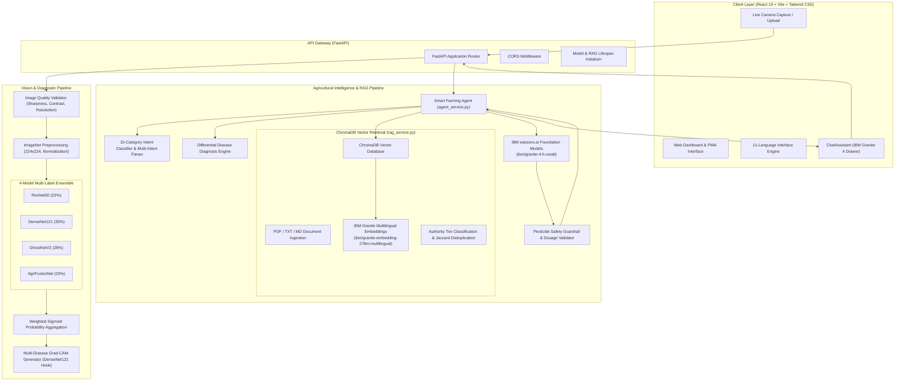

# LeafSense System Architecture

This document provides a comprehensive technical breakdown of the LeafSense architectural components, data pipelines, model ensemble mechanics, and retrieval-augmented generation workflow.

---

## 1. High-Level Architecture

LeafSense couples deep-learning computer vision with enterprise-grade foundation model reasoning to deliver end-to-end agricultural diagnostics.

---

## 2. Vision & Diagnostic Pipeline

### 2.1. Pre-Flight Image Quality Validation
Before passing leaf images to deep neural networks, `backend/image_quality.py` executes automated quality screening:
- **Resolution Verification:** Confirms minimum width and height ($\ge 224 \times 224$ pixels).
- **Blur Detection (Laplacian Variance):** Computes $\sigma^2$ of the Laplacian kernel over the grayscale image. If $\text{Var}(\nabla^2 I) < 100$, the image is flagged as blurry.
- **Contrast & Brightness Bounds:** Evaluates average luminance and standard deviation to flag underexposed or overexposed foliage.

### 2.2. 4-Model Multi-Label Ensemble
The diagnosis engine employs four distinct neural architectures to mitigate individual architectural biases:

| Model Architecture | Backbone Characteristics | Final Classification Head | Ensemble Weight ($w_m$) |
|:---|:---|:---|:---:|
| **DenseNet121** | Dense connectivity with feature reuse across dense blocks | Linear($1024 \to 17$) | **0.30** |
| **GhostNetV2** | Lightweight linear ghost feature maps for edge execution | Linear($1280 \to 17$) | **0.28** |
| **ResNet50** | Residual bottleneck blocks mitigating gradient vanishing | Linear($2048 \to 17$) | **0.22** |
| **AgriFusionNet** | Custom EfficientNet-B4 backbone with dense MLP projections | Linear($1792 \to 512 \to 256 \to 17$) | **0.20** |

#### Multi-Label Formulation
Because a single plant leaf can suffer from concurrent infections (e.g., Early Blight and Septoria simultaneously), LeafSense formulates prediction as multi-label classification using independent sigmoid units:

$$P(c) = \sum_{m=1}^{4} w_m \cdot \sigma\left(z_{m, c}\right) = \sum_{m=1}^{4} w_m \cdot \frac{1}{1 + e^{-z_{m, c}}}$$

Where:
- $c \in \{1, \dots, 17\}$ represents one of the 17 supported crop disease classes.
- $z_{m, c}$ is the unnormalized logit output of model $m$ for class $c$.
- $\sum_{m=1}^{4} w_m = 0.30 + 0.28 + 0.22 + 0.20 = 1.0$.
- Any class with aggregated probability $P(c) \ge 0.50$ (configurable via `CONFIDENCE_THRESHOLD`) is identified as an active infection.

### 2.3. Explainable AI: Multi-Disease Grad-CAM
Visual localization is computed by `backend/gradcam.py` hooked into DenseNet121's deepest convolutional layer (`features.denseblock4.denselayer16.conv2`):

1. **Gradient Computation:** For target class $c$, the gradient of logit $y^c$ with respect to feature activation map $A^k$ is computed via backpropagation:
   $$\alpha_k^c = \frac{1}{Z} \sum_{i} \sum_{j} \frac{\partial y^c}{\partial A_{i, j}^k}$$
2. **Weighted Activation Map:**
   $$L_{\text{Grad-CAM}}^c = \text{ReLU}\left( \sum_k \alpha_k^c A^k \right)$$
3. **Color-Coded Overlay:** Heatmaps for individual detected diseases are mapped to distinct spectral palettes (Red, Yellow, Blue, Green, Purple, Cyan) and composited into both individual diagnostic cards and a combined multi-disease overlay.

---

## 3. Conversational AI & RAG Pipeline

### 3.1. IBM watsonx.ai Service Layer
`backend/watsonx_service.py` integrates foundation models using the official `ibm-watsonx-ai` Python SDK:
- **Model In Use:** `ibm/granite-4-h-small` (Granite 4 foundation model).
- **Authentication:** IAM API key authenticated against the Dallas regional endpoint (`https://us-south.ml.cloud.ibm.com`).
- **Credential Hygiene:** Credentials reside exclusively in backend environment variables. Error handlers automatically sanitize and mask tokens, authorization headers, and UUIDs before returning responses to clients.

### 3.2. Vector Storage & Semantic Search (ChromaDB)
`backend/rag_service.py` manages the persistent agricultural knowledge base:
- **Embedding Generation:** Generates dense multilingual vector representations using `ibm/granite-embedding-278m-multilingual`.
- **Deduplication:** Analyzes retrieved chunks using Jaccard word-overlap similarity; chunks with $>70\%$ lexical overlap with previously accepted passages are suppressed.
- **Authority Tiering:** Classifies source citations into `official_guidance` (ICAR, KVK, Universities, CIBRC), `verified_research`, or `agricultural_reference`.

### 3.3. Cognitive Agent Reasoning Loop
`backend/agent_service.py` coordinates multi-turn conversational consultations:
1. **15-Category Intent Classification:** Deconstructs queries into single or multi-intent requests across diagnosis, chemical control, organic alternatives, soil preparation, crop rotation, and irrigation.
2. **Conversational Memory:** Preserves multi-turn dialogue history, resolves pronouns ("this disease", "that crop"), and handles user corrections ("Actually it is Potato not Tomato").
3. **Differential Disease Analysis:** Automatically generates comparative symptom profiles and field verification probes when disease ambiguity or low confidence ($<0.50$) is detected.
4. **Safety Dosage Validation:** Enforces responsible AI boundaries, preventing ungrounded chemical pesticide dosages or spray quantities.
